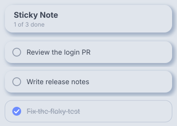
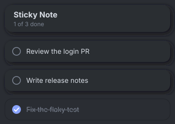

# Sticky Note Claude Mod

A sticky note that sits beside your chat in Claude Code, so your to-do list is always in view. It has a soft neumorphic look and light and dark modes.

<p>
  
  
</p>

## Why

When I work with Claude I lose track of what I still have to do. Switching to a notes app breaks focus, and typing the list into the chat would cost tokens every turn. This mod keeps the list in a pane next to the conversation. The pane runs entirely on your machine and never talks to the model, so using it costs **zero tokens**.

## Features

- To-do list in a pane beside the chat: add, check off, edit, reorder and delete items
- Undo for a deleted item or a "Clear done"
- Neumorphic style: raised cards for open items, pressed-in cards for finished ones
- Auto, light and dark themes. Auto follows your system's light/dark setting
- One shared list, or a separate list for each project folder
- Saved between sessions. Close Claude, come back tomorrow, and your list is still there
- Compact "glance" view when the pane is minimized to a widget in the desktop app
- Falls back to a plain text list in the terminal, where SVG can't be drawn
- `/sticky-note` command reopens the pane if you close it

## Quick start

Requires [Claude Code](https://claude.com/claude-code).

At the prompt of a Claude Code terminal session:

```
/plugin install sticky-note --marketplace NathanLaborada/sticky-note-claude-mod
```

Answer `y` to add the marketplace, then press Enter to pick the user scope. The note opens in every new session from then on.

From a shell instead:

```powershell
claude plugin install sticky-note --marketplace NathanLaborada/sticky-note-claude-mod
```

In the Claude desktop app, where `/plugin` does not run, click **+** next to the prompt box, choose **Plugins**, then **Add marketplace** with `NathanLaborada/sticky-note-claude-mod`, then **Add plugin**.

## Usage

| Do this | How |
| --- | --- |
| Add a to-do | Type in **Add a to-do…** and press Enter |
| Mark done / undo | ✓ / ↺ |
| Edit | ✎, change the text, press Enter (saving it empty deletes the item) |
| Move up / down | ↑ / ↓ |
| Delete | ✕ |
| Remove all finished items | **Clear done** |
| Bring back what you just deleted | **↶ Undo** |
| Switch theme | **◐ Auto** → **☀ Light** → **☾ Dark** |
| Shared list or one per project | **🌐 All folders** / **📁 This folder** |
| Reopen a closed note | type `/sticky-note` |

## How it works

The mod is one hooks module ([hooks/register.tsx](hooks/register.tsx)) for Claude Code's plugin API.

- On `session.start` it loads your saved list and theme from the plugin's own store (`$.store`) and opens a pane.
- A `ui.render` hook draws the pane. The neumorphic shapes can't be made with the built-in boxes, which have no shadows or rounded corners, so each card is a small SVG. Two `feDropShadow` filters, one lighter and one darker than the base colour, are merged to give the soft raised look. Note text is XML-escaped before it goes into the SVG.
- Buttons and inputs write to session state (`$.state`) and then to `$.store`. The state write redraws the pane, and the store write makes it persist.

Nothing in the mod calls the model, so it uses no tokens.

## Tech stack

TypeScript + JSX against the Claude Code hooks API, SVG for the visuals.

## Development

Run the tests and the validator from the repo folder:

```powershell
claude plugin test .
claude plugin validate .
```

To try a local copy without installing it, start Claude Code with `claude --plugin-dir <path to this folder>`.

## Known limitations

- Long items are cut off with `…` in the card; the full text shows when you edit it.
- Card width is estimated from the pane's width in characters, so it can look slightly off at unusual font sizes.
- The app's own text field and buttons keep their flat style. Only the cards are neumorphic.
- Auto follows your system's light/dark setting, because mods can't read the app's theme. If the app is set differently from the system, pick Light or Dark by hand.
- The text box is the app's own control, and a mod can't change its colours. Its text follows the app's theme, so with Light on a dark app it stays light. Auto avoids this.
- Undo remembers only the last delete or "Clear done".

## License

MIT. See [LICENSE](LICENSE).
